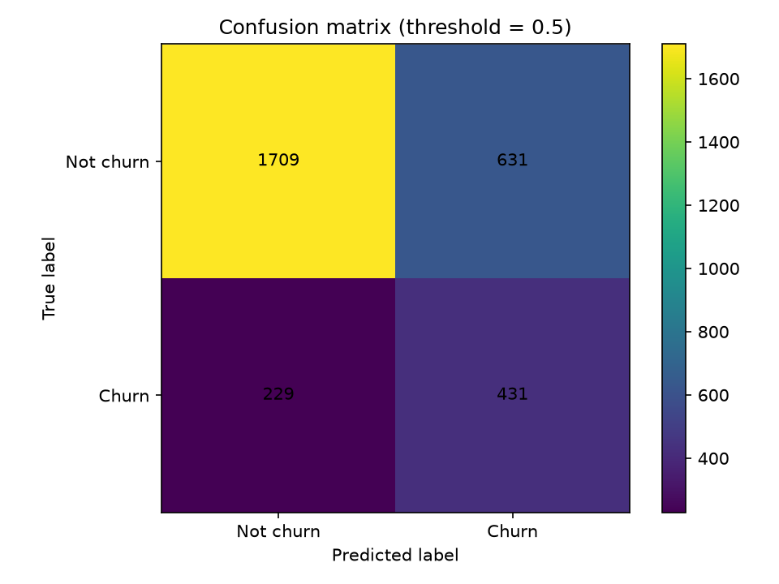
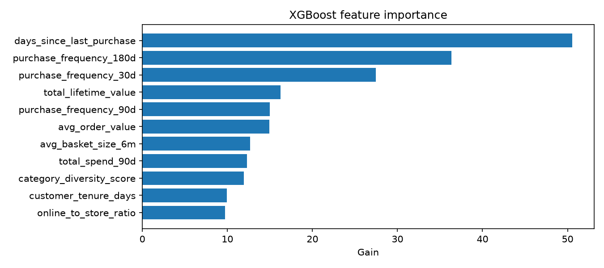

# Lab 3 — Churn Model Evaluation Report

## 1. Evaluation Overview

The objective of this evaluation is to determine whether the Northstar customer churn prediction model identifies customers at risk of churning and whether feature engineering provides a measurable improvement over a recency-only baseline.

Training data was retrieved from the Feature Store offline store using Amazon Athena. The model was evaluated on a held-out test set.

### Training and Evaluation Configuration

| Configuration | Value |
|---|---|
| Training data source | Feature Store offline store via Athena |
| Athena QueryExecutionId | See `lab3-evidence/train-final.log` |
| Random seed | [Actual seed] |
| Training set size | [Actual training size] |
| Test set size | [Actual test size] |
| XGBoost version | [Actual version] |
| Baseline feature | `days_since_last_purchase` |

## 2. Model Evaluation Metrics

| Metric | Measured Value | Requirement | Result |
|---|---:|---|---|
| AUC-ROC (test set) | [Full-model AUC] | Report; no fixed threshold | Reported |
| Precision @ top 10% | [Precision] | >= 0.50 | [Pass/Fail] |
| Recall @ top 10% | [Recall] | >= 0.25 | [Pass/Fail] |
| Recency-only baseline AUC | [Baseline AUC] | Report baseline | Reported |
| AUC lift over baseline | [AUC lift] | 95% CI must exclude zero | [Pass/Fail] |
| 95% CI lower bound | [Lower bound] | Must exclude zero as an interval | — |
| 95% CI upper bound | [Upper bound] | Must exclude zero as an interval | — |

The model was evaluated using ROC-AUC, precision at the top 10% of customers, and recall at the top 10%. Precision and recall were compared against the lab's required thresholds.

There is no absolute AUC threshold. Instead, the evaluation measures whether the full model improves upon a recency-only baseline and whether that improvement is statistically distinguishable from zero.

The recorded evaluation metrics are available in `lab3-evidence/evaluation_metrics.json`.

## 3. Recency-Only Baseline and AUC Lift

The recency-only baseline uses `days_since_last_purchase` as its only input feature. The full model uses the engineered feature set described in `lab3-model-design.md`.

AUC lift is calculated as:

**AUC lift = Full-model AUC - Recency-only baseline AUC**

The full model achieved a test AUC of **[Full-model AUC]**, compared with **[Baseline AUC]** for the recency-only baseline. The measured AUC lift was **[AUC lift]**.

### Paired Bootstrap Confidence Interval

Approximately 2,000 paired bootstrap replicates were used to estimate the uncertainty of the AUC difference. For each replicate, test-set rows were sampled with replacement, and both models were evaluated on the same sampled rows.

The 95% confidence interval was calculated using the 2.5th and 97.5th percentiles of the bootstrap AUC differences.

| Statistic | Value |
|---|---:|
| Full-model AUC | [Full-model AUC] |
| Baseline AUC | [Baseline AUC] |
| AUC lift | [AUC lift] |
| 95% confidence interval | [[Lower bound], [Upper bound]] |

**Interpretation:** [Explain whether the confidence interval excludes zero. If the entire interval is above zero, the results support the conclusion that the full model outperforms the recency-only baseline. If the interval includes zero, the evaluation does not establish a statistically distinguishable improvement.]

Using the same bootstrap sample for both models is important because it preserves the paired comparison and provides an appropriate estimate of uncertainty in the AUC difference.

## 4. Confusion Matrix

The confusion matrix at the selected classification threshold is available below.

The confusion matrix shows true positives, true negatives, false positives, and false negatives at the selected threshold. These results help explain the types of classification errors made by the model.

The confusion matrix complements the top-10% ranking metrics. The confusion matrix evaluates classification at a fixed threshold, while the top-10% metrics evaluate the model's ability to prioritize customers for targeted outreach.

## 5. Feature Importance

The model's feature-importance visualization is available below.

The feature-importance plot identifies features that contribute to the model's predictions according to the selected importance measure. These results help explain which features the model relies on when ranking customers by churn risk.

Feature importance indicates predictive contribution and should not be interpreted as proof of causation.

## 6. Loyalty-Tier Slice Evaluation

Slice evaluation measures performance across loyalty tiers to identify differences in predictive quality and potential limitations caused by small sample sizes.

The detailed results are recorded in `lab3-evidence/slice-evaluation.csv`.

| Loyalty Tier | Test n | Positives | AUC | Recall | Too Small to Conclude? |
|---|---:|---:|---:|---:|---|
| [Tier 1] | [n] | [positives] | [AUC] | [Recall] | [Yes/No] |
| [Tier 2] | [n] | [positives] | [AUC] | [Recall] | [Yes/No] |
| [Tier 3] | [n] | [positives] | [AUC] | [Recall] | [Yes/No] |
| [Tier 4] | [n] | [positives] | [AUC] | [Recall] | [Yes/No] |

### Slice Analysis

The weakest observed tier was **[Tier name]**, with an AUC of **[AUC]** and recall of **[Recall]**, based on **[n]** test examples and **[positives]** positive examples.

[Discuss differences in performance across the four tiers, identify the weakest tier, and explain any limitations caused by sample size.]

Sample size is essential when interpreting slice-level metrics. AUC can be unstable when a tier contains very few positive or negative examples. A low AUC in a small slice should not automatically be interpreted as evidence that the model performs poorly for that tier.

Any tier marked as too small to conclude from should be treated as inconclusive. Conclusions about these tiers require additional observations or further evaluation.

## 7. MLflow Experiment Tracking

The evidence collection process verified that the MLflow experiment contains at least three tracked runs with logged parameters and metrics.

The supporting evidence files are:

- `lab3-evidence/mlflow-runs.csv`
- `lab3-evidence/mlflow-app.json`

The tracked parameters include model configuration values such as `max_depth`, `eta`, and `num_round`. Experiment tracking enables reproducibility and comparison across model configurations.

The graded run should be identifiable in the MLflow records, with its parameters and evaluation metrics consistent with the evaluation report.

## 8. Model Registry

The Model Registry evidence is available in `lab3-evidence/model-registry.json`.

The evidence collection process verified that model versions were registered with the `PendingManualApproval` status and that registry metadata was consistent with the recorded evaluation metrics.

The registry evidence should identify the model version corresponding to the graded run and demonstrate consistency with the evaluation results.

## 9. Limitations

Several considerations affect the interpretation of the evaluation:

- **Split variability:** Evaluation metrics may vary across train/test splits.
- **Model version:** Different XGBoost versions can produce different metrics. The version used for the graded run must be reported.
- **Baseline comparison:** The paired bootstrap confidence interval quantifies uncertainty in the difference between the full model and the recency-only baseline.
- **Slice sample sizes:** Metrics from tiers with few examples or few positive cases may be unstable and should not support strong conclusions.
- **Feature importance:** Importance rankings describe predictive contribution and do not establish causal relationships.
- **Operational threshold:** Confusion-matrix results depend on the selected threshold, while top-10% metrics depend on ranking customers by predicted risk.

## 10. Conclusion

The full churn prediction model achieved a test AUC of **[Full-model AUC]**, precision at the top 10% of **[Precision]**, and recall at the top 10% of **[Recall]**.

The recency-only baseline achieved a test AUC of **[Baseline AUC]**, resulting in an AUC lift of **[AUC lift]** with a 95% paired-bootstrap confidence interval of **[Lower bound, Upper bound]**.

The precision requirement [was/was not] satisfied, and the recall requirement [was/was not] satisfied. The confidence interval [excluded/included] zero, indicating that the evaluation [supports/does not establish] a statistically distinguishable improvement over the recency-only baseline.

The loyalty-tier analysis identified **[Weakest tier]** as the weakest observed slice. Its results should be interpreted in light of the test-set size and number of positive cases. Any tier with insufficient observations is treated as inconclusive.

Overall, this evaluation measures the model's ability to prioritize customers for churn-prevention outreach and assesses whether feature engineering improves predictive performance beyond purchase recency alone.

## Supporting Evidence

- Training log: `lab3-evidence/train-final.log`
- Evaluation metrics: `lab3-evidence/evaluation_metrics.json`
- Athena query export: `lab3-evidence/athena-query.json`
- Confusion matrix: `lab3-evidence/confusion-matrix.png`
- Feature importance: `lab3-evidence/feature-importance.png`
- Loyalty-tier slice evaluation: `lab3-evidence/slice-evaluation.csv`
- MLflow runs: `lab3-evidence/mlflow-runs.csv`
- MLflow App export: `lab3-evidence/mlflow-app.json`
- Model Registry export: `lab3-evidence/model-registry.json`